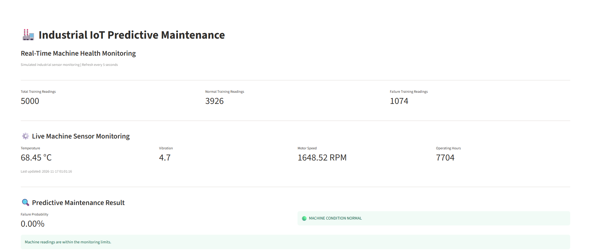

# Industrial IoT Predictive Maintenance System

## Project Overview

An Industrial IoT Predictive Maintenance System that uses simulated machine sensor data and Machine Learning to predict potential equipment failures and monitor machine health.

The system provides an interactive Streamlit dashboard for monitoring temperature, vibration, motor speed (RPM), operating hours, maintenance alerts and historical sensor trends.

## Key Features

- Industrial machine sensor data generation.
- Predictive failure detection using Random Forest.
- Machine health monitoring.
- Simulated real-time sensor updates every 5 seconds.
- Temperature, vibration and RPM visualizations.
- Normal, Warning and Critical machine status.
- Automatic maintenance event logging.
- Maintenance analytics using interactive charts.
- Downloadable maintenance reports in CSV format.

## Technologies Used

| Category | Technologies |
|---|---|
| Programming | Python |
| Machine Learning | Scikit-learn, Random Forest |
| Data Analysis | Pandas, NumPy |
| Visualization | Plotly |
| Dashboard | Streamlit |
| Data Storage | CSV |
| Development | VS Code, Git |

## Project Architecture

1. Sensor Simulation – Generates industrial machine readings.
2. Data Processing – Processes temperature, vibration, RPM and operating hours.
3. Machine Learning – Predicts potential machine failures.
4. Health Monitoring – Identifies machine health conditions.
5. Maintenance Logging – Records warning and critical events.
6. Dashboard – Displays sensor readings, predictions and analytics.

## Project Structure

```text
IndustrialIoT_PredictiveMaintenance/
│
├── data/
│   ├── machine_data.csv
│   └── maintenance_history.csv
│
├── models/
│   └── predictive_maintenance_model.pkl
│
├── src/
│   ├── generate_data.py
│   ├── train_model.py
│   ├── predict.py
│   ├── sensor_simulator.py
│   └── maintenance_logger.py
│
├── app.py
├── requirements.txt
├── .gitignore
└── README.md
```

## Installation and Execution

### 1. Clone the repository

```bash
git clone YOUR_GITHUB_REPOSITORY_URL
cd IndustrialIoT_PredictiveMaintenance
```

### 2. Create a virtual environment

```bash
python -m venv .venv
```

### 3. Activate the environment

Windows PowerShell:

```powershell
.venv\Scripts\Activate.ps1
```

### 4. Install dependencies

```bash
pip install -r requirements.txt
```

### 5. Generate the dataset

```bash
python src/generate_data.py
```

### 6. Train the machine learning model

```bash
python src/train_model.py
```

### 7. Start the dashboard

```bash
streamlit run app.py
```

## Machine Learning Model

Algorithm: Random Forest Classifier

Input Features:
- Temperature
- Vibration
- RPM
- Operating Hours

Output:
- Normal condition
- Potential machine failure

The initial model achieved 99.9% accuracy on the simulated test dataset. This result is specific to the synthetic data and does not represent validated real-world industrial performance.

## Future Improvements

- Integration with real industrial sensors.
- MQTT-based IoT communication.
- Database integration.
- Advanced predictive maintenance algorithms.
- Historical machine performance analysis.
- Cloud-based monitoring.

## Project Status

Developed as an academic and portfolio project to explore Industrial IoT, Machine Learning, predictive maintenance and data visualization.

**Note:** Sensor readings are currently simulated. The project is not connected to physical industrial machinery.
## Dashboard Preview

